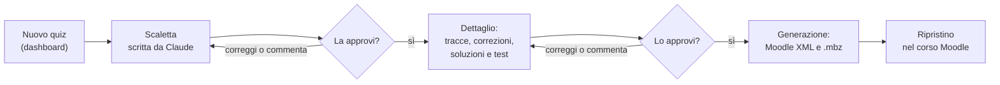

# Moodle: quiz generator

Plugin per Claude che prepara i quiz Moodle di informatica del triennio SIA: esercitazioni con spiegazione, verifiche di programmazione e di teoria, ripassi. Si parte da una richiesta a parole; Claude propone la scaletta e scrive le domande in una dashboard dove le rivedi e le approvi; alla fine ricevi il backup `.mbz` del quiz, da ripristinare nel corso Moodle con pagine, sezioni, punti e impostazioni già a posto.

Le domande coprono Cloze, risposta multipla, vero/falso, risposta breve, aperta, corrispondenza e CodeRunner JavaScript, SQL, PHP, HTML e CSS. Le domande CodeRunner arrivano con gli output attesi già calcolati eseguendo la soluzione, e quelle SQL e PHP con il database allegato.

## Che cosa serve

- Un account Claude a pagamento (Pro o superiore): i plugin non ci sono nel piano gratuito.
- L'esecuzione del codice attiva nelle impostazioni di Claude: le skill usano script per costruire XML e backup.
- Il Moodle della scuola, con i prototipi CodeRunner già installati (`sql_salvemini`, `php_mysqli_sqlite`, `php_con_test`, `css`, «Javascript (con prompt)», «Javascript (con gapfiller)»). Su un altro Moodle le domande CodeRunner vanno adattate.
- Per l'avvio automatico dei quiz dalla dashboard: il connettore Claude Code Remote e le attività programmate. Senza, tutto funziona lo stesso: il pulsante «Inizia» ti dà una frase da incollare in chat.

## Installazione

1. In Claude apri **Customize** → **Plugins** → **Add marketplace** e scrivi l'indirizzo del repository: `matteocandita-gif/moodle-quiz-generator`.
2. Nella scheda **Discover** scegli «Moodle: quiz generator» e premi **Install**.
3. In una chat nuova scrivi «installa la dashboard dei quiz» (oppure usa il comando `installa-dashboard`). Claude pubblica la tua dashboard «Bozze dei quiz», privata, e crea l'attività che avvia i quiz.
4. Apri la dashboard dal link che ti dà Claude. La prima volta che premi «Inizia», la pagina ti chiede di autorizzare il connettore Claude Code Remote: accetta.

Gli aggiornamenti arrivano dal repository: nella scheda del marketplace usa **Check for updates**, oppure attiva **Sync automatically**. Se una versione nuova cambia la pagina della dashboard, Claude ti propone di aggiornarla: i tuoi quiz restano.

## Il percorso di un quiz

1. **Nuovo quiz.** Nella dashboard: tipo di quiz, titolo, classe, argomento, tempo e la richiesta a parole; lezione o codice sono facoltativi. «Inizia» avvia una sessione di Claude che scrive la scaletta.
2. **Scaletta.** Una riga per pagina o domanda, con tipologia, punti, minuti e pagina del quiz. La rivedi nella vista Scaletta, correggi, commenti, approvi.
3. **Dettaglio.** In chat chiedi a Claude di scrivere il dettaglio: il testo di ogni domanda come lo vedrà lo studente, la correzione, le soluzioni e i test delle CodeRunner. Lo rivedi nella vista Dettaglio e lo approvi.
4. **Generazione.** In chat: «genera il quiz». Ricevi il backup `.mbz` (e, se serve, il Moodle XML delle domande).
5. **Ripristino.** Nel corso Moodle: Ripristina → carica il file → ripristina in questo corso, unendo.

La guida per l'uso di tutti i giorni è in [GUIDA.md](GUIDA.md).

## Tipi di quiz

| Sigla | Tipo | In breve |
|---|---|---|
| LIB | Libero (senza preset) | Nessuna regola prefissata: tipi, numero di domande, punti e tempi li decide la richiesta |
| ED | Esercitazione con spiegazione | Spiegazione dentro il quiz, poi esercizi guidati e finali |
| EDT | Esercitazione con spiegazione, solo teoria | Pagine di spiegazione seguite da domande di comprensione, senza codice |
| V | Verifica di programmazione | Con voto: parte base e parte avanzata, varianti per tag |
| VT | Verifica teorica | Con voto, per livelli di Bloom |
| RT | Ripasso teorico | Senza voto: risposte e spiegazioni visibili subito |
| EP | Esercitazione pratica | Solo esercizi, senza spiegazione, tipica per casa |
| ER | Esercitazione complessiva di ripasso | Rispiega gli argomenti dell'anno prima |

Le regole didattiche (punti, tempi, struttura delle verifiche, stile delle domande, versioni per studenti con PDP) sono quelle con cui il plugin è nato e valgono per tutti; dove una tua scelta è diversa, dilla nella richiesta o nei commenti e Claude la segue per quel quiz.

## Che cosa contiene

| Skill | Che cosa fa |
|---|---|
| `progettazione-quiz` | Punto di partenza di ogni quiz: tipo, scaletta e tracce nella dashboard |
| `materiali-moodle` | Dal database della dashboard al Moodle XML e al backup `.mbz`; domande singole, pagine di teoria, lettura e importazione di backup |
| `verifiche-programmazione` | Regole delle verifiche di programmazione JavaScript, SQL e PHP |
| `domande-coderunner-js` | Domande CodeRunner JavaScript |
| `domande-coderunner-sql` | Domande CodeRunner SQL, con il database SQLite allegato |
| `domande-php-mysqli-mock` | Domande CodeRunner PHP con database simulato |
| `database-didattici` | Database di prova coerenti in tre taglie, per CodeRunner e phpMyAdmin, con un catalogo |
| `diagrammi-er` | Diagrammi E/R nella notazione del libro, da una descrizione testuale: file draw.io da ritoccare e immagine PNG |

Il comando `installa-dashboard` installa o aggiorna la dashboard.

Le skill si usano anche da sole, fuori dalla dashboard: «una Cloze sulle JOIN», «un esercizio sui cicli while da correggere in automatico», «un database con tre tabelle per una lezione in phpMyAdmin», «disegna lo schema E/R della biblioteca».

## Autore e licenza

Matteo Candita. Le novità di ogni versione sono in [CHANGELOG.md](CHANGELOG.md).

Licenza [CC BY-NC-ND 4.0](LICENSE): puoi usare il plugin e condividerlo così com'è, citando l'autore, per scopi non commerciali; non puoi distribuirne versioni modificate. Segnalazioni e proposte sono benvenute, ma le modifiche al repository le fa solo l'autore.
